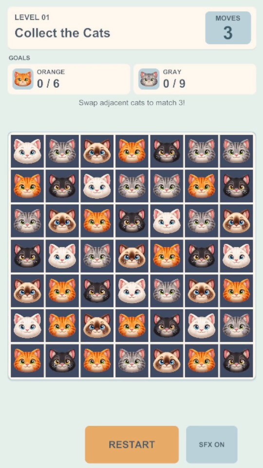

# CatMatch3

A cat-themed 2D Match-3 puzzle game developed with Unity 6 and C#.

**[Watch Gameplay Demo](Media/CatMatch3_Gameplay_Demo.mp4)** — approximately 35 seconds, recorded in the Unity Editor for this portfolio.

## Core Features

- 7x7 grid with tap and swipe swapping.
- Match detection, gravity, refill and multi-wave cascades.
- Horizontal and vertical Striped Cats, including chain activations.
- Two authored deterministic puzzle levels.
- Cat collection and fixed paw-cell objectives.
- Move limits, win/fail results, retry and level progression.
- Visual effects, responsive portrait UI and sound feedback.

## Technical Highlights

- Pure C# gameplay core separated from Unity presentation.
- Seeded deterministic resolution for reproducible puzzles.
- Exhaustive verification of unique winning routes for both levels.
- 101 EditMode tests in the established test suite.

## Technology

Unity **6000.3.8f1**, **C#**, **Unity UI (uGUI)** and the **2D Built-In Render Pipeline**.

## Open and Play

1. Clone or download this repository and open the project folder through Unity Hub using **Unity 6000.3.8f1**.
2. Allow Unity to import assets and restore packages, then open the [Gameplay scene](Assets/_CatMatch3/Scenes/Gameplay.unity).
3. Set the Game view to **9:16 portrait** and press **Play**. Tap adjacent cats or swipe/drag to swap them and complete each level's objectives within its move limit.

## Artwork

The cat-head artwork was created with AI assistance.

## Development Notes

See the [historical development and QA documentation](docs/DevelopmentNotes.md) for architecture details, puzzle verification, setup history and QA procedures.
